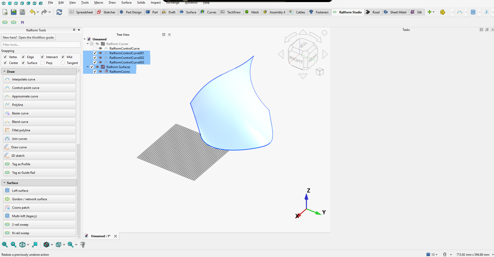

# Railform Studio (FreeCAD workbench)

A curated **curve → surface** workbench for automotive-grade modeling. It ships
**native OCCT implementations of every curated action**, so it runs fully
standalone — no mandatory third-party workbench. The optional **Curves**
workbench (Grellier) is used only as a *fallback engine* for a handful of
selections the native path doesn't yet resolve.



*The Railform Studio workbench in FreeCAD 1.1: the tool shelf with snapping
toggles and the Draw / Surface groups (left), the model tree, and a Coons patch
surfaced from its boundary curves.*

## Install

**Via the Addon Manager (recommended)** — in FreeCAD, open *Tools → Addon
Manager*, search for **Railform Studio**, install, then restart FreeCAD and
pick **Railform Studio** in the workbench dropdown.

**Manually** — clone or download this repository into your FreeCAD user `Mod`
folder (shown in *Preferences → General → Paths*, e.g. on Windows
`%APPDATA%\FreeCAD\Mod\`) so that `InitGui.py` sits directly under
`Mod/RailformStudio/`. Restart FreeCAD and select the workbench.

**Requirements:** FreeCAD 1.0 or newer (developed and exercised on FreeCAD
1.1). Geometry is pure OCCT via `Part` — no mandatory third-party workbench;
the optional Curves workbench enables a few fallback engines only.

## Quick start

1. Switch to the **Railform Studio** workbench. The Report view names the
   engine detected (or confirms standalone mode).
2. **Draw** (tool shelf, left): author points — on a construction plane, snapped
   to 3D, or typed into the X/Y/Z table — and create a curve from them
   (interpolated, control-point, approximated, polyline, or Bezier).
3. **Surface**: build a Loft, Gordon / network surface, Coons patch, or sweep
   (two-rail or multi-rail; a single rail gives a pipe sweep). Results are
   re-editable parametric objects.
4. **Surface / Solids**: offset, trim (by curve or intersection), match
   (G1/G2), blend, stitch, thicken or shell a surface into solids — then
   booleans, mirroring (optionally with seam welding), and mesh/scan-to-surface
   fitting.
5. **Inspect**: surface review (numeric continuity report) and the workflow
   guide.
6. **Exchange**: import Blender Railform rails (JSON → exact NURBS curves) or
   export hidden-line drawings as SVG.

## Try it (2 minutes)

A ready-made script builds two curved patches with a gap, blends them to G2,
prints the numeric continuity at both seams, and gives the blend a wall
thickness:

```text
FreeCADCmd.exe examples/try_blend_and_thickness.py        (headless)
```

or, inside FreeCAD, in the Python console:

```python
exec(open(r"<path to>/RailformStudio/examples/try_blend_and_thickness.py").read())
```

Expected output (verified on FreeCAD 1.1.4):

```text
left seam   G0 8.88e-16   G1 0.0000 deg   G2 0.00000 (1/mm)   -> G2
right seam  G0 9.93e-16   G1 0.0000 deg   G2 0.00000 (1/mm)   -> G2
blend thickness: OK t=1.5 Symmetric | solids: 1 | volume: 159.5 mm^3
thickness off  : off | solids: 0
```

Then, in the GUI, select the `RailformBlendSurf` object and edit its
properties:

- **Continuity** (`G0`/`G1`/`G2`) and **Scale** (tangent strength) change the
  blend on recompute.
- **Thickness** (`0` = plain surface), **ThicknessMode** (`Outward`, `Inward`,
  `Symmetric`) and the read-only **ThicknessStatus** are on every free-form
  surface feature (Loft, Gordon, Coons, Sweep, SweepN, Fill, Match,
  ExtendSurf, BlendSurf, BlendSurfClosed, N-sided). The surface is rebuilt on
  each recompute and thickened from scratch, so nothing compounds and setting
  `Thickness` back to `0` restores the plain surface.
- Run **Inspect → Surface review** for the numeric continuity report on any
  selection of faces.

## Known limitations

- **Surface match (`match_surface`) rebuilds the target from its boundary data
  only.** The target's interior shape and its two side boundaries are replaced
  by the profile curves' end curves (only the corner points are kept), so
  features inside the target are lost. When the boundaries are knot-compatible
  the exact matchers (`match_surface_exact_g1/g2`) keep the target's control
  net and are used first; they refuse antiparallel or trimmed edges and fall
  back to the sampled path.
- **Continuity grades are in new units.** `surface_deviation()`'s `max_g2` is
  now the difference in cross-direction normal curvature (1/length); the old
  raw second-derivative difference is `g2_raw`. Scripts or thresholds written
  against the old `max_g2` need re-tuning.
- **Blend and match profiles change shape on recompute.** Handle length is now
  `chord * scale` (it was effectively chord/9 to chord/21), so models saved
  with an earlier version look different after recompute. Set **Scale** to about 0.33 if
  you want the old tightness.
- **Thickness can fail where the surface is tighter than the wall.** If the
  thickness reaches the surface's minimum curvature radius, OCCT's offset may
  fail or self-intersect on the concave side. `ThicknessStatus` warns when
  `thickness >= min radius` and, on failure, the plain surface is kept with the
  reason shown. A Loft with `Solid` on is already a solid and is not thickened.
- **Extract sections** pulls live cross-section curves (constant-U) or
  rail-wise curves (constant-V) out of a sweep, loft or pipe; **Sections to
  curves** splits them into individual Profile / Guide-Rail curves for
  Loft / Sweep / SweepN. Rebuilding a sweep from its own extracted rails and
  sections reproduces it to ~1e-5 mm (2-rail, N-rail and pipe sweeps). On a
  single-rail pipe the Rails direction follows points on the profile as the
  moving frame twists, so those curves can spiral; use Cross-sections.
- Class-A claims are numeric, sampled checks, not a certified tolerance
  analysis: grade your own seams with the Surface review report.
- Some actions still lean on the optional Curves workbench as a fallback; see
  *Dependencies*.

## Tested with

| FreeCAD | OS | Status |
|---|---|---|
| **1.1.4** | Windows 11 | **Tested.** Headless suites (`test_core.py`, `test_panel_logic.py`, `test_panel_base.py`, `test_bezier_handles.py`, `test_provider_chains.py`, `rfstudio/test_gui_imports.py`) and the real-GUI command test (`test_gui_commands.py`, 123/123) all pass. |
| 1.0.x | any | **Not tested.** `package.xml` declares 1.0 as the floor because the APIs used are 1.0-era; treat 1.0 as unverified. |
| Linux / macOS | — | **Not tested** locally. A GitHub Actions workflow (`.github/workflows/test.yml`) runs the headless suites on Ubuntu with FreeCAD 1.1 for PRs to `main`. |

The demo script above has only been run headless; the GUI viewport has not
been screenshot-verified.

## Features

The tool shelf groups the curated actions in workflow order (filter box,
collapsible sections whose state is remembered):

| Group | Tools |
|---|---|
| **Draw** | Interpolate curve · control-point curve · approximate curve · polyline · Bezier curve (tangent handles) · 3D sketch · blend curve (G1/G2) · fillet polyline · join curves · freehand draw tool |
| **Surface** | Loft (with guide rails) · multi loft · Gordon / network surface · Coons patch · two-rail sweep · multi-rail sweep (every rail anchors the surface; exact Gordon route where the network allows) · N-sided fill · surface match (G2) · closed-loop blend (G1/G2) · sketch on surface · trim surface · trim by intersection · offset · thicken · shell · stitch shell · extract sections · sections to curves |
| **Solids** | Boolean union / subtract / intersect · mesh/scan to surface · mirror · mirror group |
| **Inspect** | Surface review (continuity + draft report) · workflow guide |
| **Exchange** | Blender Railform rail import (JSON → exact NURBS curves) · hidden-line drawing export (SVG) |

Viewport aids: kind-coloured snapping with Draft-style markers, toggles and a
live ΔXYZ readout; in-viewport editing of control points, B-spline knots and
Bezier handles with live updates; NURBS push/pull via double-click.

See [CHANGELOG.md](CHANGELOG.md) for what's changed recently.

## Dependencies
- **Required:** none beyond FreeCAD itself (geometry is pure OCCT via `Part`).
- **Optional:** the **Curves** workbench — install it only for the engine-first
  fallback path on a few actions (e.g. `RFS_BlendSurf` falls back to Curves'
  `BlendSurf2` for selections its native path refuses). Everything works
  without it; the workbench reports at activation which optional engine,
  if any, it found.

Every curated action has an ordered **provider chain** (`engines.PROVIDERS`):
a native implementation first, the Curves command as a fallback where one
exists. `deps.report_single_points_of_failure` therefore reports an empty list
— no curated action depends on a single external engine any more.
`engines.validate_providers()` statically checks every chain (typo'd native
names, unknown provider kinds, DELEGATIONS/PROVIDERS drift) at workbench
activation and in `test_core.py`.

## For developers

### Layout
| Path | Role | Testable headless? |
|------|------|--------------------|
| `rfstudio/core/` | **Gui-free** geometry package: OCCT surfacing, curves, trimming, manufacturing, QA, Blender rail interchange (JSON → exact NURBS) | ✅ `test_core.py` |
| `rfstudio/parametric.py` | Parametric FeaturePython objects (Loft, Gordon, Coons, sweeps, mirror, …) | partial |
| `rfstudio/engines.py` | Provider chains (native-first) + the Curves fallback map | partial |
| `rfstudio/deps.py` | Optional-engine detection + lazy command registration | partial |
| `rfstudio/panel_base.py` | Shared panel scaffolding: selection helpers, `_CurveGroup`, `_EditPanelBase`/`_ReportPanelBase` (open/commit/abort-transaction + teardown) | ❌ GUI only |
| `rfstudio/panel_*.py` | Task panels: curve, surface, solids, QA, import, sketch3d, nurbspull, lawcurve | ❌ GUI only |
| `rfstudio/editmode.py` | In-viewport editors (control points, knots, Bezier handles) + snapping | ❌ GUI only |
| `rfstudio/toolshelf.py` | Left-docked tool shelf (filter, collapsible sections, engine-aware greying) | ❌ GUI only |
| `rfstudio/snaputil.py` · `snapsettings.py` · `statusbar.py` | Ranked snapping, snap on/off settings, status-bar messaging | snaputil ✅ |
| `rfstudio/commands/` (package) | `ProviderCommand` + `PanelCommand` + curated toolbars | ❌ GUI only |
| `InitGui.py` · `rfstudio/workbench.py` | Workbench registration | ❌ GUI only |

> **Design rule:** Curves imports `FreeCAD.Gui` at load, and so does anything
> that imports a `rfstudio.panel_*` module (transitively via `FreeCADGui`), so
> those can't run under `freecadcmd`. Everything we verify headlessly therefore
> lives in `rfstudio/core/` (geometry) or `panel_logic.py` (panel decision
> logic, no FreeCADGui/PySide dependency); the rest — widget layout, dialogs,
> viewport overlays — is GUI-tested by hand.

## Verify headlessly

With FreeCAD's `freecadcmd` (or `freecad.exe`) on your machine — shown here via
a typical Windows install path, adjust to yours:

```powershell
& "C:\Program Files\FreeCAD 1.1\bin\freecadcmd.exe" test_core.py
& "C:\Program Files\FreeCAD 1.1\bin\freecadcmd.exe" test_panel_logic.py
python rfstudio\test_gui_imports.py        # GUI static smoke (<1s, no FreeCAD)
python test_panel_base.py                  # panel scaffolding (mocked Qt)
```
Expect `core tests done` / `panel_logic tests done` with no `FAIL` lines, and
`All checks passed (27 modules, ...)` from the GUI harness. That harness fakes
FreeCAD/Qt/Coin and statically checks the whole panel layer — mocked imports,
undefined self-calls, bare undefined names, cross-module references,
import-time Qt class bases, and event-callback add/remove/null symmetry. It has
caught real shipped bugs (deleted class headers, a stranded widget block in the
sketch panel). It cannot verify runtime behavior — that needs a live FreeCAD
session (see below).

## GUI smoke test (what only real Qt/Coin can show)
1. Restart FreeCAD → pick **Railform Studio** in the workbench dropdown.
2. The Report view should say which optional engine was detected, or that it's
   running standalone (no Curves).
3. The left **Railform Tools** shelf appears, grouped Draw /
   Surface / Solids / Inspect / Exchange; the filter box and collapsible
   sections work.
4. **Native action:** draw ≥ 3 spline points, create a curve, open it for
   editing — control points, knots (cyan diamonds) and axis arrows show in the
   viewport; dragging a point updates the curve live.
5. **Surface:** build a loft/sweep from profiles → a surface is created and
   re-editable.
6. **Fallback (optional):** with Curves installed, an action whose native path
   refuses a selection should bounce into the Curves command.

### Most likely things to break (and where to look)
- Workbench doesn't appear → `InitGui.py`/`workbench.py` import error; check the
  Report view.
- A toolbar button errors → provider-chain failure; it now also flashes on the
  status bar (see `statusbar.flash`), with detail in the Report view.
- Task panel doesn't open → PySide import form; on some 1.1 builds widgets are
  under `QtWidgets` (handled by `compat.get_qt_widgets`).

## License
[GPL-3.0-or-later](LICENSE).
